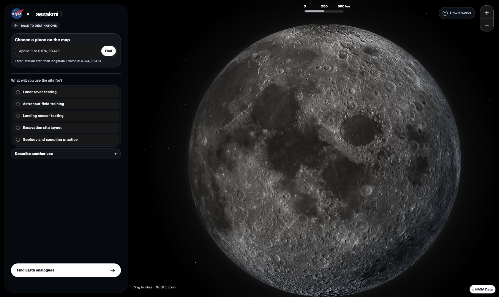
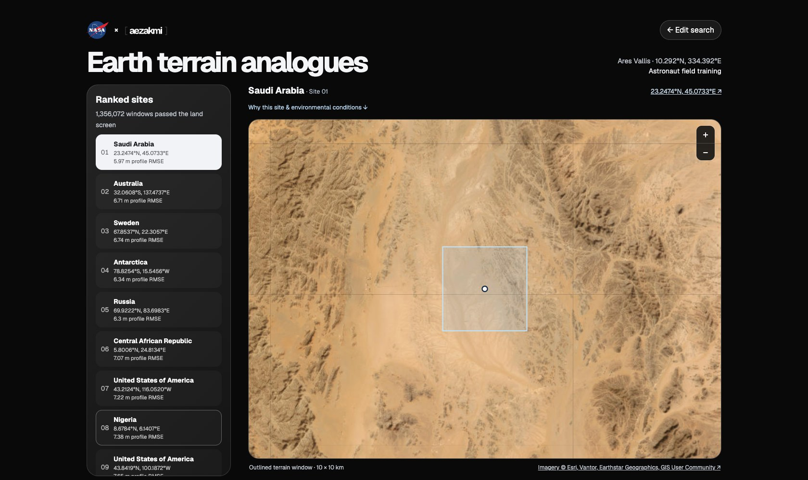
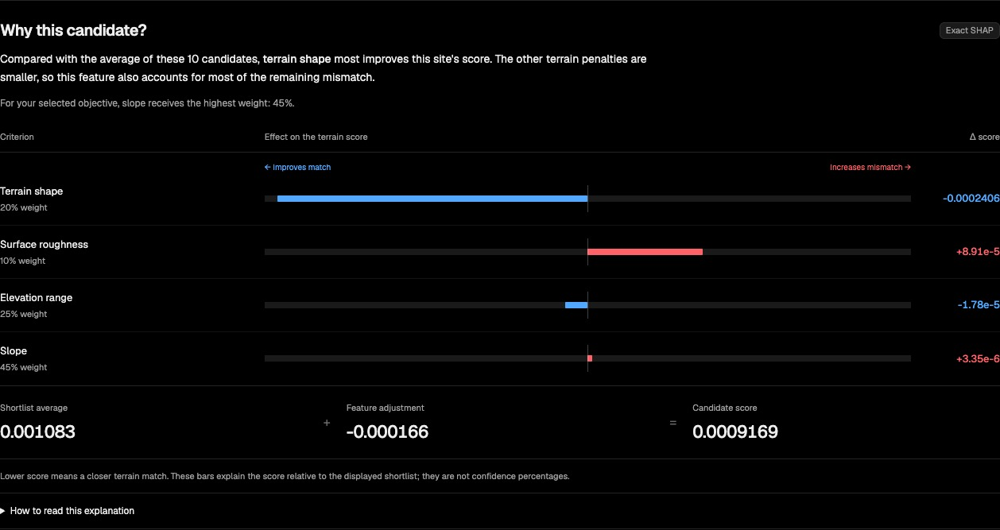

# Moon and Mars explorer

Choose a destination, choose a test, and explore matching Earth terrain.

**[Open the website](https://nasa.aezakmi.org) · [Presentation (PDF)](https://github.com/naza-aezakmi/.github/blob/main/profile/presentation.pdf) · [Matching method](https://github.com/naza-aezakmi/ml/blob/main/docs/MODEL_CARD.md) · [API](https://api.nasa.aezakmi.org/docs)**



## Use it

1. Open the Moon or Mars. Click the globe, search a landmark, or enter latitude and longitude.
2. Select a task: rover testing, astronaut training, landing sensors, excavation layout or geology practice. You can also describe another use.
3. Press **Find Earth analogues** to see ten candidates.

Each candidate has a country, coordinates, satellite imagery and a terrain comparison. The outlined area is about **10 × 10 km**.



Open **Why this site & environmental conditions** to see what helped the match and what differs. SHAP bars explain the terrain score relative to the average of the displayed candidates. The environmental passport shows available temperature, humidity, precipitation, wind and pressure data separately.



A short guide appears on the first visit. **How it works** opens it again. The guide preference is stored in a first-party cookie for one year.

## How it connects

The browser calls the Nuxt server, which forwards requests to our [FastAPI service](https://github.com/naza-aezakmi/api). The API compares four terrain characteristics across **1,356,072 eligible Earth windows**. The chosen task changes their weights. Climate is separate context.

The terrain grid describes regional landforms. It cannot measure rocks at a rover's wheels or establish that a field site is ready for use.

## Run locally

Requires **Node.js 22** and **pnpm 9.15.9**.

```bash
corepack enable
pnpm install --frozen-lockfile
pnpm dev
```

Open `http://localhost:3000`. For a production build, use `pnpm build` and `pnpm preview`.

Built with **Nuxt, Vue, TypeScript and Three.js**. See [development and deployment](docs/DEVELOPMENT.md) for API settings, checks and loading behaviour.

Part of the [Aezakmi project](https://github.com/naza-aezakmi). Planet imagery comes from NASA Trek; Earth imagery comes from Esri and its contributors. [Image sources](public/textures/SOURCES.md). This is an independent project.
